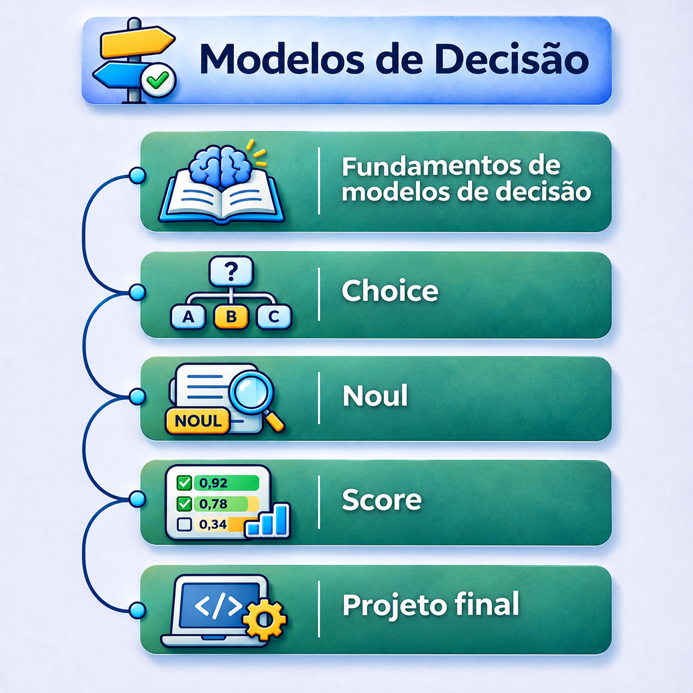

<div align="center">
    

# 🔹Bloco 6: Modelos de Decisão (System One Models)

> Modelos que não geram texto: recebem um estado e perguntas tipadas e devolvem decisões com probabilidade.

<p align="center">
  <a href="https://www.python.org/">
    
  </a>
  <a href="https://docs.typesafe.ai/">
    
  </a>
  <a href="https://huggingface.co/convaiinnovations/laya-multilingual">
    
  </a>
  <a href="https://langchain-ai.github.io/langgraph/">
    
  </a>
  <a href="https://github.com/astral-sh/uv">
    
  </a>
</p>

<div align="center">

### Tecnologias e padrões utilizados ao longo do módulo

Jev • Laya • Choice • Noul • Score • guardrail • roteamento • verificação de saída • agente híbrido em LangGraph

</div>


<div align="center">

</div>

</div>

## Por que este bloco existe

Os blocos anteriores usam LLMs para tudo, inclusive para decidir: rotear um ticket, escolher uma tool, barrar uma mensagem, conferir uma resposta. Cada uma dessas decisões vira um prompt, um JSON gerado token a token e alguns segundos de espera.

Um modelo de decisão faz essas perguntas sem gerar texto. Devolve a probabilidade de cada resposta, em milissegundos e sem tokens de saída. O bloco mostra o que é isso, como usar os três tipos de pergunta e onde ele substitui o LLM num sistema real. Em todos os scripts, você vê os tokens e a latência de cada chamada.

## 📚 Ementa do Módulo

### [Aula 1: Fundamentos de modelos de decisão](./01-decision-fundamentals)
- **Pergunta-chave:** por que gerar texto para responder uma pergunta de múltipla escolha?
- O que é um modelo de decisão e o Jev; a mesma decisão no Jev, no GPT-5.6 Luna e no Claude Sonnet 5.5; e nos outros modelos de decisão (Laya, Gemini Decision 1, OpenAI Decisions API).

### [Aula 2: Choice](./02-choice)
- **Pergunta-chave:** quantas vezes o seu agente lê a descrição de todas as tools só para escolher uma?
- Classificação de documentos (com os limites de entrada de cada modelo) e escolha de tool, nos quatro modelos de decisão.

### [Aula 3: Noul](./03-noul)
- **Pergunta-chave:** "esta mensagem é perigosa?" é uma pergunta ou cinco?
- Perguntas de sim ou não nos quatro modelos: checklist de contrato, guardrail com prompt injection e auditoria de edital de concurso.

### [Aula 4: Score](./04-score)
- **Pergunta-chave:** como transformar "quão bom é este candidato?" em números que ordenam uma fila?
- Escalas ordenadas nos quatro modelos: ranking de currículos e juiz de respostas.

### [Aula 5: Projeto final](./05-final-project)
- **Pergunta-chave:** quantas das chamadas do seu agente precisam mesmo de um LLM?
- Agente de atendimento em LangGraph: guardrail, triagem e verificação no Jev, resposta no LLM.

---

## Os modelos

| Modelo | Origem | Como o bloco acessa | Aulas |
|---|---|---|---|
| **Jev** | TypeSafe AI, API | `typesafe-sdk` | todas |
| **GPT-5.6 Luna** e **Claude Sonnet 5.5** | OpenAI e Anthropic | `init_chat_model` do LangChain | 1 e 5 |
| **Laya** (`convaiinnovations/laya-multilingual`) | Convai Innovations, Apache 2.0 | local, mesma API do Jev | todas |
| **Gemini Decision 1** e **OpenAI Decisions API** | Google e OpenAI, API | HTTP direto (`httpx`) | 1, 2, 3 e 4 |

## Glossário

- **Modelo de decisão (System One Model):** modelo que devolve decisões tipadas com probabilidade, sem gerar texto.
- **Estado:** o contexto da decisão (um ticket, uma mensagem, uma resposta a conferir).
- **Choice:** escolhe uma opção de uma lista. Devolve a opção, a confiança e a probabilidade de cada opção.
- **Noul:** a probabilidade de uma afirmação ser verdadeira.
- **Score:** um nível numa rubrica ordenada. Devolve a probabilidade de cada nível e o valor esperado.
- **Limiar:** o valor de confiança a partir do qual o código age sozinho.

## Como rodar

Configure o `.env` da raiz (veja o `.env.example`):

| Variável | Para quê |
|---|---|
| `TYPESAFE_API_KEY` | chamar o Jev (todas as aulas) |
| `ANTHROPIC_API_KEY` | Claude Sonnet 5.5 (aulas 1 e 5) |
| `OPENAI_API_KEY` | GPT-5.6 Luna (aula 1; na aula 5, com `LLM_MODEL=openai:gpt-5.6-luna`) e OpenAI Decisions API (aulas 1 a 4) |
| `GEMINI_API_KEY` | Gemini Decision 1 (aulas 1 a 4) |
| `LAYA_BASE_URL` | onde o Laya responde (padrão `http://127.0.0.1:8001`) |

```bash
uv sync                                                        # da raiz do repositório
python 06-decision-models/01-decision-fundamentals/01_first_decision.py
docker compose --profile decision up -d laya                   # o Laya, usado em todas as aulas
```

Cada script é independente: abra, leia de cima para baixo e rode.

## Referências

- [TypeSafe: documentação](https://docs.typesafe.ai/), [SDK Python](https://docs.typesafe.ai/sdk/python/) e [primitivos](https://docs.typesafe.ai/primitives/choice)
- [Laya: documentação](https://nandhakishorm.github.io/laya/), [model card multilíngue](https://huggingface.co/convaiinnovations/laya-multilingual) e [GitHub](https://github.com/NandhaKishorM/laya)
- [Kahneman (2011). Rápido e Devagar: Duas Formas de Pensar](https://en.wikipedia.org/wiki/Thinking,_Fast_and_Slow)
- [awesome-decision-models](https://github.com/sfmqrb/awesome-decision-models): lista comunitária de modelos de decisão
